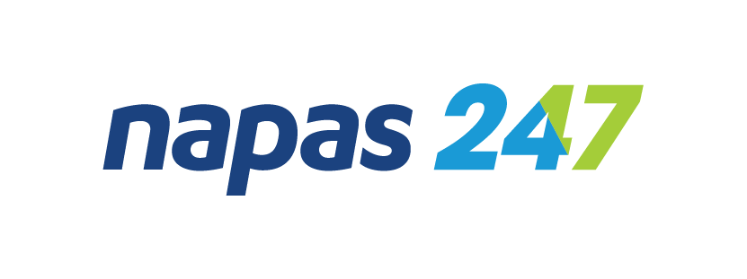
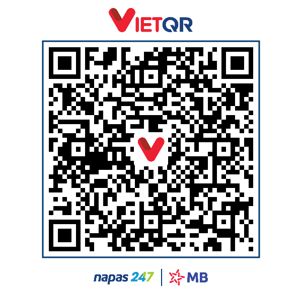
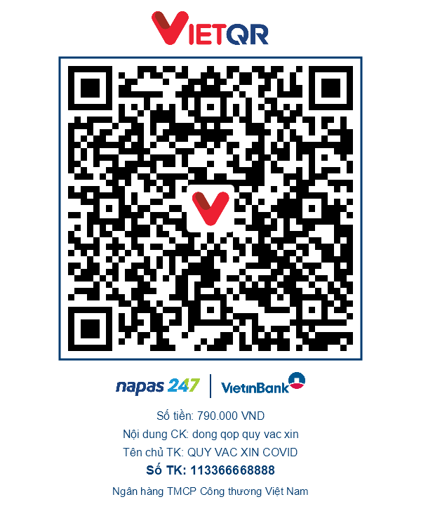
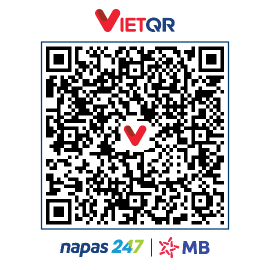

# VietQR.Core — Hệ Sinh Thái Mã QR Thanh Toán NAPAS247 cho .NET

<p align="center">
  
  &nbsp;&nbsp;&nbsp;&nbsp;&nbsp;&nbsp;&nbsp;&nbsp;
  
</p>

<p align="center">
  <b>Giải pháp mã nguồn mở cho thanh toán VietQR (NAPAS247 &amp; EMVCo) trên nền tảng .NET</b><br>
  Danh mục 76+ ngân hàng &amp; font Unicode nhúng sẵn trong DLL &bull; Render PNG / WebP / SVG &bull; Giải mã từ chuỗi hoặc ảnh
</p>

<p align="center">
  <a href="https://github.com/Ngochiendev/vietqr-core/actions/workflows/ci.yml"></a>
  <a href="https://www.nuget.org/packages/VietQR.Core"></a>
  <a href="https://www.nuget.org/packages/VietQR.Core"></a>
  <a href="#"></a>
  <a href="https://github.com/Ngochiendev/vietqr-core/blob/main/LICENSE"></a>
</p>

---

## 📢 Bối Cảnh Phát Triển & So Sánh Kỹ Thuật với Dịch Vụ VietQR.io

### 1. Tại sao `VietQR.Core` ra đời?

Ngày 14/10/2026, nhóm phát triển VietQR Payment Kit đã đưa ra **[Thông báo cập nhật chính thức](https://www.vietqr.io/thong-bao-cap-nhat)** với các thay đổi mang tính bước ngoặt:

- **Ngừng cổng API Generate (`api.vietqr.io`) từ ngày 01/01/2027:** Bắt buộc mọi hệ thống doanh nghiệp phải chuyển sang thư viện `vietqr-core` để tạo mã QR trực tiếp trên hệ thống của mình, không còn phụ thuộc vào API mạng bên ngoài.
- **Ngừng tiếp nhận Custom Theme / Template mới** trên cổng quản lý `my.vietqr.io`.

Tuy nhiên, phía nhà cung cấp chỉ đưa ra thông báo chuyển đổi chung chung mà **chưa cung cấp một bộ mã nguồn (Source Code) mở, minh bạch, hoàn chỉnh và có kiến trúc rõ ràng cho cộng đồng lập trình viên .NET**.

Chính vì vậy, dự án **`VietQR.Core`** này được phát triển độc lập với mục tiêu: Cung cấp cho cộng đồng .NET một giải pháp mã nguồn mở **chuẩn hóa 100% theo quy chuẩn NAPAS247 & EMVCo**, hoàn toàn miễn phí, kiến trúc trong suốt và đạt hiệu năng tối đa.

---

### 2. Bảng So Sánh Tính Năng & Kiến Trúc Kỹ Thuật

Dưới đây là bảng đối chiếu giữa phương thức gọi API dịch vụ qua mạng và việc tích hợp trực tiếp thư viện `VietQR.Core` vào ứng dụng:

| Tiêu chí                      |            Dịch vụ API qua mạng             | Thư viện `VietQR.Core` (In-process) | Ghi chú kỹ thuật                                                                |
| :---------------------------- | :-----------------------------------------: | :---------------------------------: | :------------------------------------------------------------------------------ |
| **Phương thức hoạt động**     |     Gửi HTTP request ra ngoài Internet      |   Tích hợp trực tiếp vào ứng dụng   | Chạy trực tiếp trong mã nguồn, không phát sinh network round-trip.              |
| **Độ trễ xử lý (Latency)**    |   ~100 ms _(theo công bố mới của VietQR)_   |              ~1 - 5 ms              | Tạo ma trận QR trực tiếp trong RAM, không bị ảnh hưởng bởi độ trễ đường truyền. |
| **Môi trường hoạt động**      |        Cần kết nối Internet liên tục        |          Hoạt động Offline          | Thích hợp cho mạng nội bộ (Intranet ngân hàng, Docker, On-premise).             |
| **Bảo mật dữ liệu**           | Gửi thông tin thanh toán qua API bên thứ ba |        Dữ liệu xử lý nội bộ         | Thông tin số tài khoản và đơn hàng được giữ trọn vẹn trong hệ thống của bạn.    |
| **Tùy biến mẫu & Logo**       |    Sử dụng mẫu mặc định của cổng dịch vụ    |     3 mẫu giao diện + Logo tâm      | Có sẵn mẫu `compact`, `print`, `qr_only` và hỗ trợ nhúng `CustomCenterLogo`.    |
| **Định dạng xuất ảnh**        |            Ưu tiên định dạng SVG            |          SVG, WebP và PNG           | Hỗ trợ WebP tối ưu dung lượng và PNG tương thích rộng rãi.                      |
| **Khả năng giải mã (Decode)** |            Chỉ tạo mã (1 chiều)             |    Hỗ trợ 2 chiều (Tạo & Đọc mã)    | Bổ sung `VietQrParser` và `VietQrDecoder` đọc dữ liệu từ chuỗi hoặc ảnh.        |
| **Tối ưu chịu tải lớn**       |       Phụ thuộc giới hạn kết nối HTTP       |    Hỗ trợ `RenderToStreamAsync`     | Ghi thẳng dữ liệu ra luồng Stream, giảm tải cấp phát mảng byte lên LOH.         |
| **Giấy phép & Chi phí**       |      Theo chính sách dịch vụ bên ngoài      |     Mã nguồn mở (Giấy phép MIT)     | Hoàn toàn miễn phí, tự do tùy biến và tích hợp vào các dự án thương mại.        |

---

## 🖼️ Mẫu Thẻ Thanh Toán Thực Tế (Visual Showcase)

Toàn bộ ảnh mẫu được sinh tự động bằng chính thư viện `VietQR.Core`:

|                         Mẫu 1: `compact` (Mặc định)                          |                       Mẫu 2: `print` (Quầy thu ngân)                        |                           Mẫu 3: `card` (Thẻ ATM NAPAS)                           |
| :--------------------------------------------------------------------------: | :-------------------------------------------------------------------------: | :-------------------------------------------------------------------------------: |
|  |    |        |
|      **Chuyển nhanh đến STK**<br>Header VietQR, logo Napas & Ngân hàng.      | **Thẻ in POS / Để bàn**<br>In to rõ Số tiền (VNĐ), Nội dung CK, Tên chủ TK. | **Chuyển nhanh đến Thẻ**<br>Định danh `QRIBFTTC`, tự động chuyển nhãn `"Số thẻ"`. |

|                          Mẫu 4: Tùy biến Logo Đối tác                          |                             Mẫu 5: `qr_only` (Mã QR vuông)                              |
| :----------------------------------------------------------------------------: | :-------------------------------------------------------------------------------------: |
|   |              |
| **Nhúng Logo Riêng ở Tâm**<br>Giữ mã QR đen trắng chuẩn (`#000000`/`#FFFFFF`). | **Mã QR Vuông Tinh Gọn**<br>Kích thước tùy chỉnh (`Size = 500`), có icon VietQR ở giữa. |

---

## 🚀 Khởi Chạy Web API Trực Quan (Quick Start with API)

Dự án có sẵn một Web API hoàn chỉnh. Clone repo và chạy trong 10 giây:

```bash
# 1. Clone mã nguồn
git clone https://github.com/Ngochiendev/vietqr-core.git
cd vietqr-core

# 2. Khởi chạy Web API
dotnet run --project src/VietQR.Api
```

Mở trình duyệt truy cập Swagger UI:
👉 **`http://localhost:5000/swagger`** (hoặc port hiển thị trên console).

### Các Endpoint chính:

- **Tạo mã QR & Render ảnh:**
  `GET /api/v1/qr/generate?bin=970422&accountNo=056789799999&amount=2000&description=Thanh+toan+cafe`
- **Tra cứu danh sách ngân hàng thành viên:**
  `GET /api/v1/banks`

---

## 📦 Sử Dụng Package NuGet Trong Ứng Dụng Khác

```bash
dotnet add package VietQR.Core
```

👉 **Hướng dẫn chi tiết dành cho package (ảnh + code mẫu đầy đủ):** [src/VietQR.Core/README.md](src/VietQR.Core/README.md) — nội dung này cũng hiển thị trên trang [NuGet.org/packages/VietQR.Core](https://www.nuget.org/packages/VietQR.Core).

---

## 💡 Hướng Dẫn Code Mẫu Cốt Lõi

### 1. Tạo chuỗi VietQR & Render ảnh thẻ

```csharp
using VietQR.Core;

// 1. Tạo chuỗi mã QR Động NAPAS247 (Tài khoản MBBank, gắn sẵn số tiền)
string payload = VietQrPayload.CreateDynamic(
    BankBin.Create("970422"),                // MBBank
    "056789799999",                          // Số tài khoản
    amount: 2000,
    description: "Thanh toan cafe");

// 2. Render ảnh thẻ thanh toán (hoàn toàn offline — logo & font nằm trong DLL)
var imageService = new QrImageService();
byte[] pngBytes = await imageService.RenderBytesAsync(payload, new QrRenderOptions
{
    Template = "compact",
    BankBin = "970422",
    AccountNo = "056789799999",
    AccountName = "VO NGOC HIEN",
    Amount = 2000,
    Description = "Thanh toan cafe"
});

await File.WriteAllBytesAsync("vietqr.png", pngBytes);
```

Chuỗi EMVCo sinh ra theo mẫu chuẩn NAPAS247 (có sẵn CRC Tag 63 ở cuối):

```text
00020101021238570010A0000007270127000697042201120567897999990208QRIBFTTA
5303704540420005802VN62180814thanh toan test6304xxxx
```

### 2. Chuyển tiền qua Thẻ (Card - `QRIBFTTC`)

```csharp
// Luôn truyền TƯỜNG MINH serviceType: VietQrServiceType.Card
string cardPayload = VietQrPayload.CreateDynamic(
    BankBin.Create("970422"),
    "9704222028493997",                      // Số thẻ NAPAS
    amount: 1000,
    serviceType: VietQrServiceType.Card,     // Định danh mã dịch vụ QRIBFTTC
    description: "Chuyen vao the MB");

// Render ảnh — tự động đổi nhãn "Số TK" thành "Số thẻ"
byte[] cardBytes = await imageService.RenderBytesAsync(cardPayload, new QrRenderOptions
{
    Template = "compact",
    BankBin = "970422",
    AccountNo = "9704222028493997",
    AccountName = "VO NGOC HIEN",
    Amount = 1000,
    ServiceType = VietQrServiceType.Card
});
```

### 3. Giải mã ngược mã QR từ chuỗi hoặc ảnh (Parser / Decoder)

```csharp
// (a) Phân tích từ chuỗi EMVCo — kiểm tra checksum CRC16:
Result<VietQrInfo> result = VietQrParser.Parse(payload);
if (result.IsSuccess)
{
    VietQrInfo info = result.Value!;
    Console.WriteLine($"Ngân hàng: {info.BankInfo?.ShortName}");
    Console.WriteLine($"Số TK/Thẻ: {info.AccountNo}");
    Console.WriteLine($"Số tiền: {info.Amount:N0} {info.Currency}");
    Console.WriteLine($"CRC16 hợp lệ: {info.IsValidCrc}");
}

// (b) Đọc từ ảnh tải lên (PNG, WebP, JPEG, BMP):
byte[] imageBytes = await File.ReadAllBytesAsync("customer_uploaded_qr.png");
Result<VietQrInfo> decoded = VietQrDecoder.Decode(imageBytes);
```

### 4. Xuất WebP / SVG / Stream (tối ưu server)

```csharp
// WebP — dung lượng nhỏ hơn PNG khoảng 30-40%
byte[] webp = await imageService.RenderWebpBytesAsync(payload,
    new QrRenderOptions { Template = "compact", Quality = 80 });
await imageService.SaveWebpAsync("vietqr.webp", payload);

// SVG vector — thuần C# (không cần Skia native), dùng cho in ấn decal khổ lớn
string svgXml = VietQrSvgRenderer.Render(payload, size: 500);

// Stream — ghi trực tiếp ra Response, không cấp phát byte[] lên LOH
await imageService.RenderToStreamAsync(payload, httpContext.Response.Body,
    new QrRenderOptions { Format = QrImageFormat.Webp });
```

---

## 🔌 Tích Hợp ASP.NET Core (Dependency Injection)

```csharp
// Program.cs
using VietQR.Core;

builder.Services.AddVietQrCore(options =>
{
    options.DefaultTemplate = "compact";
});
```

```csharp
// Minimal API hoặc Controller — inject trực tiếp
app.MapGet("/api/qr", async (QrImageService qrService, string bin, string stk, long amount) =>
{
    string payload = VietQrPayload.Create(BankBin.Create(bin), stk, amount);
    byte[] image = await qrService.RenderBytesAsync(payload, new QrRenderOptions
    {
        Template = "compact",
        BankBin = bin,
        AccountNo = stk,
        Amount = amount
    });
    return Results.File(image, "image/png");
});
```

---

## 🤝 Đóng Góp (Contributing)

Dự án luôn hoan nghênh mọi đóng góp từ cộng đồng (Issue, Pull Request, Báo lỗi hoặc Đề xuất tính năng mới).  
Vui lòng xem chi tiết quy trình cộng tác, tiêu chuẩn code và quy ước commit tại **[CONTRIBUTING.md](CONTRIBUTING.md)**.

---

## 🙏 Lời Cảm Ơn (Acknowledgments)

Xin gửi lời cảm ơn chân thành đến **[NAPAS (Công ty Cổ phần Thanh toán Quốc gia Việt Nam)](https://napas.com.vn)** cùng **[Sáng kiến VietQR](https://vietqr.net)** đã xây dựng chuẩn mực thanh toán số thông minh, tiện lợi cho hàng triệu người dân và doanh nghiệp Việt Nam, đồng thời cung cấp **[tài liệu quy chuẩn kỹ thuật](docs/QR_Format_T&C_v1.0_VN_092021.pdf)** làm cơ sở để cộng đồng cùng phát triển.

---

## ⚠️ Tuyên Bố Miễn Trừ Trách Nhiệm (Disclaimer)

- **Thương hiệu:** `VietQR`® và `NAPAS247`® là nhãn hiệu đã đăng ký thuộc quyền sở hữu của **NAPAS (Công ty Cổ phần Thanh toán Quốc gia Việt Nam)** và các tổ chức tương ứng. Dự án này là thư viện mã nguồn mở độc lập phi lợi nhuận, không phải sản phẩm chính thức do NAPAS hoặc vietqr.io phát hành.
- **Trách nhiệm giao dịch:** Thư viện được cung cấp theo nguyên tắc "nguyên trạng" (AS IS) theo giấy phép MIT. Người sử dụng và đơn vị tích hợp chịu hoàn toàn trách nhiệm về tính chính xác của dữ liệu thanh toán (Số tài khoản, Mã ngân hàng, Số tiền) trước khi xuất mã QR. Tác giả không chịu trách nhiệm đối với bất kỳ sự cố chuyển nhầm, tổn thất tài chính hay gián đoạn nào phát sinh từ việc ứng dụng thư viện trong thực tế. Chi tiết xem tại **[DISCLAIMER.md](DISCLAIMER.md)**.

---

## 📄 Giấy Phép (License)

Dự án được phân phối dưới giấy phép mã nguồn mở **[MIT License](LICENSE)**.  
Bản quyền thuộc về © 2026 **Ngochiendev**.
