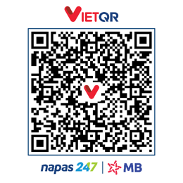
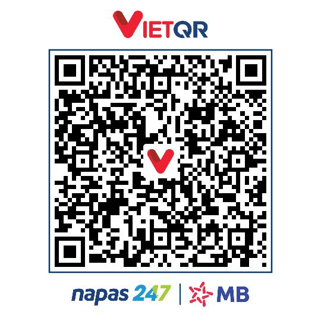
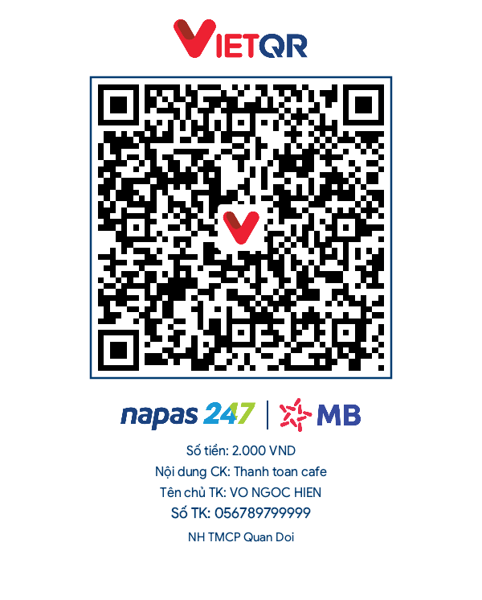

# VietQR.Core

[](https://www.nuget.org/packages/VietQR.Core)
[](https://www.nuget.org/packages/VietQR.Core)
[](https://github.com/Ngochiendev/vietqr-core#supported-runtimes)
[](https://github.com/Ngochiendev/vietqr-core/blob/main/LICENSE)

**VietQR.Core** generates and renders payment QR codes for Vietnam according to the **NAPAS247 / EMVCo** standard.

Given a bank BIN and an account number, the library produces a checksummed EMVCo payload (QRIBFTTA to account / QRIBFTTC to card), plus a rendered PNG card in three templates — using SkiaSharp, entirely offline. The full bank catalog (76+ banks) and all bank logos ship **embedded in the package**, so it works out of the box with no configuration or network access.

## Getting started

### Prerequisites

- Any .NET runtime listed in the **Supported runtimes** section below.
- No other setup required — assets, logo files and the bank catalog are embedded in the package.

### Install

```sh
dotnet add package VietQR.Core
```

> Pin to a specific release when needed:
> `dotnet add package VietQR.Core --version <x.y.z>`

`dotnet add` resolves the latest stable version and writes the exact
`PackageReference` (with version) into your `.csproj`. Prefer this over a
copy-pasted `PackageReference` element: a version-less reference is allowed
only under Central Package Management (`Directory.Packages.props`) — otherwise
NuGet treats it as a floating `*` and emits an `NU1604` warning.

## Usage

### 1. Generate the EMV payload string

No dependency injection required:

```csharp
using VietQR.Core;

// Dynamic QR (QRIBFTTA — transfer to account)
string payload = VietQrPayload.Create(
    BankBin.Create("970422"),        // MB Bank BIN, exactly 6 digits
    accountNo: "056789799999",
    amount: 50000,
    description: "hoc phi");

// 00020101021238520010A000000727...
Console.WriteLine(payload);
```

Omit `amount` to emit a static QR (`Point of Initiation Method = 11`).
Use `serviceType: VietQrServiceType.Card` for QRIBFTTC (transfer to card).
Rendered card-payload sample: [Resources/examples/vietqr-card.png](Resources/examples/vietqr-card.png).

<p align="center">
  
</p>

The library automatically strips Vietnamese diacritics and rejects control
characters, so `description` input is safe to pass as-is.

### 2. Look up a bank

The catalog is embedded — zero config, works offline:

```csharp
using VietQR.Core;

var catalog = EmbeddedBankCatalog.Instance;
BankInfo? bank = await catalog.FindAsync("970422");

// bank.Bin == "970422", bank.Code == "MB", bank.ShortName == "MBBank"
```

`FindAsync` accepts a BIN, a short code (`"MB"`) or a short name (`"MBBank"`),
and is case-insensitive.
See `IBankCatalog` for the full surface, including `GetAllAsync()`.

### 3. Render the card image

Register the library in DI, then request `IQrImageRenderer`. In an ASP.NET Core
app the container is provided by the host; the snippet below builds it manually
so it compiles as-is in any project:

```csharp
using VietQR.Core;
using Microsoft.Extensions.DependencyInjection;

var services = new ServiceCollection();
services.AddVietQrCore();          // anywhere during app startup

using var provider = services.BuildServiceProvider();
var generator = provider.GetRequiredService<IQrGenerator>();
var renderer  = provider.GetRequiredService<IQrImageRenderer>();

string payload = generator.Generate(new VietQrRequest(
    Bin: BankBin.Create("970422"),
    AccountNo: "056789799999",
    Amount: 50000,
    Description: "hoc phi"));

var options = new QrRenderOptions
{
    Template = "print",              // "compact" (default) | "qr_only" | "print"
    BankBin = "970422",
    AccountNo = "056789799999",
    AccountName = "NGUYEN VAN A",
    Amount = 50000,
    Description = "hoc phi",
    Size = 500                       // only used by the "qr_only" template
};

byte[] png = await renderer.RenderPngAsync(payload, options);   // ct defaults to CancellationToken.None
string dataUrl = $"data:image/png;base64,{Convert.ToBase64String(png)}";
```

`RenderPngAsync` returns PNG `byte[]` — embed directly in HTML
(`data:image/png;base64,...`), write to disk, or return from your own REST API.

`AddVietQrCore()` accepts an optional `VietQrOptions` record:

```csharp
services.AddVietQrCore(options =>
{
    options.DefaultTemplate = "compact";  // template used when QrRenderOptions.Template is not set
    options.DataPath = "/data/vietqr";    // optional data directory for Docker/K8s mounts
});
```

### Available templates

Canvas sizes, straight from the rendering code (`QrImageService.cs`):

| Template  | Canvas size                                                        | Recommended for                                         |
| --------- | ------------------------------------------------------------------ | ------------------------------------------------------- |
| `compact` | 540 × 540                                                          | Default card: VietQR header + QR + Napas247 + bank logo |
| `qr_only` | 500 × 500 (configurable via `QrRenderOptions.Size`)                | Minimal square QR with the VietQR logo in the center    |
| `print`   | 600 × dynamic (590 px + 28 px per info line + 16 px bottom margin) | Receipt-style card with amount, transfer note, account  |

| `qr_only`                                        | `compact`                                         | `print`                                       |
| ------------------------------------------------ | ------------------------------------------------- | --------------------------------------------- |
|  |  |  |

### 4. Parse a payload and decode images

Two entry points, both returning `Result<T>` instead of throwing:

```csharp
using VietQR.Core;

// (a) Parse a payload string (CRC16 validated, strict TLV)
Result<VietQrInfo> parsed = VietQrParser.Parse(payload);
if (parsed.IsSuccess)
{
    VietQrInfo info = parsed.Value!;
    // info.BankInfo, info.AccountNo, info.Amount, info.ServiceType,
    // info.Description, info.BillNumber, info.ReferenceLabel, info.IsValidCrc
}

// (b) Decode from an uploaded image (PNG / WebP / JPEG / BMP)
byte[] imageBytes = await File.ReadAllBytesAsync("customer_uploaded.png");
Result<VietQrInfo> decoded = VietQrDecoder.Decode(imageBytes);
```

On failure `result.Error` carries a stable code from `VietQrErrors`
(`qr.missing_param`, `qr.invalid_amount`, `qr.invalid_bin`, `qr.bank_not_found`,
`qr.invalid_payload`, `qr.invalid_crc`, `qr.not_vietqr`,
`qr.image_decode_failed`, ...).

`VietQrParseOptions` tunes the parser defaults:

| Property           | Default | Description                                                                  |
| ------------------ | ------- | ---------------------------------------------------------------------------- |
| `StrictCrc`        | `true`  | Reject payloads whose CRC tag does not match the content.                    |
| `MaxPayloadLength` | `1024`  | Cap on payload length before parsing (untrusted input from camera/webhooks). |
| `BankCatalog`      | `null`  | Custom `IBankCatalog`; defaults to the embedded catalog.                     |

`VietQrDecoder.Decode` also accepts `Stream?` and `SKBitmap?` overloads, plus
`DecodeAsync(...)` — see the public surface of `VietQrDecoder`.

### 5. Output formats and streams

`QrRenderOptions.Format` selects the output image format — `Png` (default),
`Webp` or `Svg`:

```csharp
// WebP — roughly 30-40% smaller than PNG at the same quality
var webpOptions = new QrRenderOptions { Template = "compact", Format = QrImageFormat.Webp, Quality = 80 };
byte[] webp = await renderer.RenderAsync(payload, webpOptions);   // honors options.Format
await File.WriteAllBytesAsync("vietqr.webp", webp);

// SVG — pure C# string, no native dependency
string svgXml = VietQrSvgRenderer.Render(payload, size: 500);

// Streams — write straight into a response/file stream, no byte[] buffer
await renderer.RenderToStreamAsync(payload, httpContext.Response.Body,
    new QrRenderOptions { Template = "compact", Format = QrImageFormat.Webp });
```

`QrImageService` mirrors the same surface when used directly
(`RenderBytesAsync`, `RenderWebpBytesAsync`, `SaveWebpAsync`, `RenderSvgAsync`,
`SaveAsync`).

### 6. Custom center logo

`QrRenderOptions` accepts a custom brand logo embedded in the center of the QR
— as bytes or as a Base64 data URL:

```csharp
var branded = new QrRenderOptions
{
    Template = "qr_only",
    Size = 500,
    CustomCenterLogo = File.ReadAllBytes("my_brand_logo.png"),
    // CustomCenterLogoBase64 = "data:image/png;base64,...",
    CenterLogoRatio = 0.20f          // logo width vs QR width (safe range 0.10-0.28)
};
```

The QR module matrix stays black-on-white (`#000000` / `#FFFFFF`), so branded
cards remain scannable by banking apps. Rendered examples shipped in the
package:
[Resources/examples/vietqr-card.png](Resources/examples/vietqr-card.png)
(QRIBFTTC card) and
[Resources/examples/vietqr-custom-logo.png](Resources/examples/vietqr-custom-logo.png).

<p align="center">
  
</p>

### Utilities

The `VietQr` class also exposes useful static helpers (used by our own test suite):

- `VietQr.GenCRCCode(string content)` — compute the CRC16-CCITT (Tag 63) for the
  payload **without** the 4-character CRC suffix.
- `VietQr.VerifyCRC(string content)` — validate a complete payload end-to-end;
  the string must already end with the `6304XXXX` CRC tag.
- `VietQr.ExtractBinFromEmvCo(string content)` — pull the BIN out of any
  compliant payload.

## Supported runtimes

| TFM     | Support  |
| ------- | -------- |
| net6.0  | ✅       |
| net8.0  | ✅ (LTS) |
| net9.0  | ✅       |
| net10.0 | ✅ (LTS) |

Native SkiaSharp binaries are packaged for Windows, Linux and macOS, so
`dotnet publish` works for all major targets without extra steps.

## Feedback

Bugs, feature requests and questions go to the
[GitHub issue tracker](https://github.com/Ngochiendev/vietqr-core/issues).
Release notes for every version are published on the
[GitHub Releases](https://github.com/Ngochiendev/vietqr-core/releases) page,
and on nuget.org under each package version.

## Contributing

See [CONTRIBUTING.md](https://github.com/Ngochiendev/vietqr-core/blob/main/CONTRIBUTING.md).
Please include the NAPAS247 reference payload you expect, along with your test,
for anything affecting generated output.

## Disclaimer & Trademark

VietQR® and NAPAS247® are registered trademarks of NAPAS (National Payment Corporation of Vietnam) and related entities. This project is an independent, non-profit open-source library and is not an official product of NAPAS or vietqr.io. Always verify the recipient account details before executing transactions. See [DISCLAIMER.md](https://github.com/Ngochiendev/vietqr-core/blob/main/DISCLAIMER.md).

## License

Copyright © 2026 Ngochiendev.
This project is [MIT-licensed](https://github.com/Ngochiendev/vietqr-core/blob/main/LICENSE).
